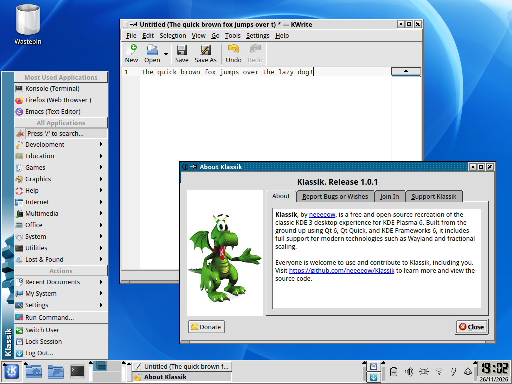

# Klassik
A modern recreation of the classic KDE 3 desktop experience for KDE Plasma 6, built from the ground up using Qt 6, Qt Quick and KDE Frameworks 6, with full support for modern technologies such as Wayland and fractional scaling.



## Features
- **Classic panel applets:** Reimplementations of various KDE 3 panel applets, written in C++ and QML, all of which use `QStyle` and `QPainter` for drawing, ensuring they look as close to the original KDE 3 applets as possible. Currently included:
  - K Menu (application menu)
  - Launcher
  - Task manager
  - Lock / log out buttons
  - Digital / analog clock
- **Custom panel containment:** KDE 3-style panel containment that uses `QStyle` and `QPainter` to draw the panel background (with support for custom background images) and applet handles.
- **Application style:** Default KDE 2/3 `QStyle` theme, rewritten in Qt 6.
- **Window decorations:** Ports of old KDE 3 `KWin` themes to `KDecoration3`. Currently included:
  - KDE 2
- **Color schemes:** Various color schemes included with KDE 3, ported to KDE Plasma.
- **Wallpapers:** A set of wallpapers originally included with KDE 3.

## Requirements
Requires KDE Plasma 6.4 or later. For compilation, the following C++ development libraries are required:
- **Qt 6:** `Core`, `Widgets`, `Qml`, `Quick`, `QuickPrivate`
- **KDE Frameworks 6:** `I18n`, `Service`, `KIO`, `Config`, `CoreAddons`, `IconThemes`, `XmlGui`, `WidgetsAddons`, `Notifications`
- **KDE Plasma 6:** `Plasma`, `PlasmaQuick`, `PlasmaActivities`, `PlasmaActivitiesStats`, `LibKWorkspace`, `KDecoration3`

## Installation

### 1. Download Klassik
Clone the repository:
```bash
git clone https://github.com/neeeeow/Klassik.git
cd Klassik
```
> [!CAUTION]
> By default, the `master` branch is cloned. Do not clone the `develop` branch unless you are a developer/contributor; it contains work-in-progress features and may be unstable!

### 2. Compile and install
Compile using `cmake`:
```bash
cmake -B build -DCMAKE_BUILD_TYPE=Release
cmake --build build
sudo cmake --install build
```

### 3. Enable Klassik
Go to **System Settings, Colors & Themes, Global Theme** and select **Klassik**.
> [!IMPORTANT]
> Ensure *Desktop and window layout* is checked before pressing apply so that the Klassik panel gets loaded.

## Support Klassik
Klassik is, and will always remain, free of charge; however, creating and maintaining it requires a great deal of time and effort. Financial donations go a long way towards supporting Klassik's development and can be made through the [GitHub Sponsors](https://github.com/sponsors/neeeeow) page.

If you are not in a position to donate, that is completely fine. Simply using Klassik and spreading the word is equally appreciated!
